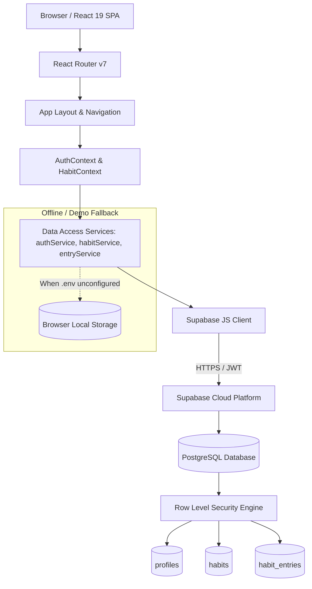

# HabitFlow 🌿

> **Small steps. Lasting change.**

A complete, professional, responsive full-stack habit tracking web application designed for personal productivity, college project demonstrations, and developer portfolios.

Built with **React 19**, **TypeScript**, **Tailwind CSS v4**, and **Supabase (PostgreSQL with Row Level Security)**.

---

## 📌 Table of Contents
1. [Project Overview](#-project-overview)
2. [Problem Statement & Objectives](#-problem-statement--objectives)
3. [Key Features](#-key-features)
4. [Color Palette & Design System](#-color-palette--design-system)
5. [Technology Stack](#-technology-stack)
6. [System Architecture](#-system-architecture)
7. [Database Schema & Security](#-database-schema--security)
8. [Local Installation & Setup](#-local-installation--setup)
9. [Supabase Backend Setup](#-supabase-backend-setup)
10. [Environment Variables](#-environment-variables)
11. [Running & Testing](#-running--testing)
12. [Deployment Guide (Vercel & Supabase)](#-deployment-guide-vercel--supabase)
13. [College Presentation & Viva Preparation](#-college-presentation--viva-preparation)
14. [Limitations & Future Enhancements](#-limitations--future-enhancements)

---

## 🌿 Project Overview

**HabitFlow** is an intuitive daily habit tracker crafted around the science of micro-habits. It avoids overwhelming users with convoluted mechanics, instead delivering:
- Fast, 1-click completion logging.
- Clear, real-time visual progress.
- Flexible scheduling (e.g., daily, specific weekdays, or custom weekly targets).
- Robust streak calculations that never penalize non-scheduled days.
- Full data ownership with JSON and CSV exports.

---

## 🎯 Problem Statement & Objectives

### The Problem
* Most productivity apps suffer from feature bloat or punitive streak algorithms (e.g., missing a Tuesday workout resets a streak even if the user only scheduled workouts for Monday, Wednesday, and Friday).
* Traditional client-server models often lack database-level security or leak sensitive credentials to client bundles.
* Timezone drift frequently causes habits marked late at night to roll over to the incorrect UTC calendar date.

### The Objectives
1. **Sustainable Habit Building:** Provide a simple, satisfying interface with immediate visual rewards.
2. **True Relational Security:** Enforce data isolation using **PostgreSQL Row Level Security (RLS)** directly in the database engine.
3. **Accurate Local Time Handling:** Eliminate UTC off-by-one errors using local calendar ISO strings (`YYYY-MM-DD`).
4. **Demonstrable Quality:** Deliver a 100% working application with automated unit tests, clean documentation, and an offline demo mode for viva presentations.

---

## ✨ Key Features

### 1. Daily Dashboard
- **Contextual Greeting:** Greets the user (Good morning/afternoon/evening) based on their local time.
- **Dynamic Progress Bar:** Shows "X of Y habits completed (Z%)" computed directly from database entries. Zero-division safe when no habits are scheduled.
- **Interactive Habit List:** One-click checkmark toggle with celebratory confetti animation and optimistic UI updates.
- **Starter Habit Suggestions:** Quick 1-click addition of foundational habits (Morning Exercise, Read a Book, Practice Coding, Practice English).

### 2. Habit Management (Full CRUD)
- **Create & Edit:** Habit title, description, category, custom icon, accent color, measurable targets (e.g., 20 mins, 10 pages), and start dates.
- **Smart Scheduling:** Supports *Every Day*, *Specific Weekdays* (e.g., Mon, Wed, Fri), or *Weekly Frequency* (e.g., 3x per week).
- **Archive & Restore:** Safely pause habits without deleting historical logs.
- **Delete with Confirmation:** Destructive confirmation modal preventing accidental deletions.

### 3. Monthly Calendar View
- Month-by-month navigation with a quick "Today" jump button.
- Status indicators for all completed, partially completed, incomplete, and future dates.
- Interactive side panel to inspect and retrospectively log habits for any selected date.

### 4. Progress Analytics
- **KPI Metrics:** Weekly completion rate, monthly completion rate, current streak, and longest historical streak.
- **Weekly Bar Chart:** Visualizes scheduled vs. completed occurrences for each day of the week using **Recharts**.
- **30-Day Heatmap:** Visual consistency grid inspired by GitHub contributions.
- **Performance Rankings:** Highlights top-performing habits (≥ 70%) and habits needing attention.

### 5. Settings & Data Portability
- Profile display name and timezone configuration.
- Theme Switcher: **Warm Ivory** (Light) and **Forest Night** (Dark) with CSS variable persistence.
- **Data Export:** Instant downloads in **JSON** (full relational backup) and **CSV** (spreadsheet-ready format).
- Offline Demo Mode banner and step-by-step Supabase connection modal.

---

## 🎨 Color Palette & Design System

HabitFlow uses a curated, accessible color palette tailored for calming productivity:

| Color Role | Hex Code | Purpose |
| :--- | :--- | :--- |
| **Forest Green** | `#244C3A` | Primary brand color, main buttons, completed indicators |
| **Deep Forest Green** | `#18372B` | Hover states, sidebar headers, dark accents |
| **Warm Ivory** | `#F8F7F2` | Default page background in light mode |
| **White** | `#FFFFFF` | Content card backgrounds |
| **Muted Sage** | `#DCE8DC` | Subtle highlights, active tab pills, badge backgrounds |
| **Sage Green** | `#7FA58A` | Progress indicators, borders, secondary accents |
| **Terracotta** | `#C77B5B` | Streak badges, energy accents, special highlights |
| **Primary Text** | `#252B27` | High-contrast readable body and title text |
| **Secondary Text** | `#737B73` | Subtitles, labels, and timestamps |
| **Border Color** | `#E6E8E0` | Restrained card and input borders |
| **Error / Destructive** | `#B91C1C` | Accessible dark red for delete alerts and errors |
| **Warning** | `#D97706` | Accessible amber for partial completion notes |

* **Typography:** `Inter` for crisp body copy and `Manrope` for distinctive titles.
* **Layout:** 8px spacing grid with responsive sidebar (desktop) and bottom navigation (mobile).

---

## 💻 Technology Stack

### Frontend
- **Framework:** React 19 (SPA)
- **Build Tool:** Vite 8
- **Language:** TypeScript
- **Styling:** Tailwind CSS v4 (`@tailwindcss/vite`)
- **Routing:** React Router v7 (`react-router-dom`)
- **Icons:** Lucide React (`lucide-react`)
- **Charts:** Recharts (`recharts`)
- **Delight:** Canvas Confetti (`canvas-confetti`)
- **Testing:** Vitest (`vitest`)

### Backend & Database
- **Backend as a Service:** Supabase
- **Database Engine:** PostgreSQL 15+
- **Security:** PostgreSQL Row Level Security (RLS) policies
- **Authentication:** Supabase Auth (Email & Password, JWT sessions)
- **Client Library:** `@supabase/supabase-js`

---

## 🏛 System Architecture



---

## 🗄 Database Schema & Security

The complete database initialization script is located at:  
[`supabase/schema.sql`](file:///v:/HABIT%20FLOW/supabase/schema.sql)

### 1. `profiles` Table
Stores user preferences and display metadata linked to `auth.users(id)`.
- `id UUID PRIMARY KEY REFERENCES auth.users(id) ON DELETE CASCADE`
- `display_name TEXT`
- `timezone TEXT DEFAULT 'UTC'`
- `theme TEXT DEFAULT 'light'`
- `created_at TIMESTAMPTZ`
- `updated_at TIMESTAMPTZ`

### 2. `habits` Table
Stores habit rules, categories, icons, and schedules.
- `id UUID PRIMARY KEY DEFAULT gen_random_uuid()`
- `user_id UUID NOT NULL REFERENCES auth.users(id) ON DELETE CASCADE`
- `title TEXT NOT NULL`
- `description TEXT`
- `category TEXT NOT NULL DEFAULT 'Personal'`
- `icon TEXT NOT NULL DEFAULT 'check-circle'`
- `color TEXT NOT NULL DEFAULT '#244C3A'`
- `schedule JSONB NOT NULL DEFAULT '{"type": "daily"}'`
- `target_value NUMERIC`
- `target_unit TEXT`
- `start_date DATE NOT NULL DEFAULT CURRENT_DATE`
- `archived_at TIMESTAMPTZ`
- `created_at TIMESTAMPTZ`
- `updated_at TIMESTAMPTZ`

### 3. `habit_entries` Table
Stores daily tracking completions and progress values.
- `id UUID PRIMARY KEY DEFAULT gen_random_uuid()`
- `user_id UUID NOT NULL REFERENCES auth.users(id) ON DELETE CASCADE`
- `habit_id UUID NOT NULL REFERENCES habits(id) ON DELETE CASCADE`
- `entry_date DATE NOT NULL`
- `completed BOOLEAN NOT NULL DEFAULT false`
- `progress_value NUMERIC`
- `completed_at TIMESTAMPTZ`
- `created_at TIMESTAMPTZ`
- `updated_at TIMESTAMPTZ`
- **Constraint:** `CONSTRAINT unique_habit_date_entry UNIQUE (habit_id, entry_date)`
- **Integrity Trigger:** Validates that the `habit_id` actually belongs to `user_id` before inserting or updating.

### Row Level Security (RLS)
All tables have RLS enabled with granular policies for `SELECT`, `INSERT`, `UPDATE`, and `DELETE`.
Every policy verifies `auth.uid() = user_id`, guaranteeing multi-tenant isolation directly in the database.

---

## 🚀 Local Installation & Setup

### Prerequisites
- **Node.js:** v18 or newer (tested on v26+)
- **npm:** v9 or newer

### Steps
1. Clone or open the repository:
   ```bash
   cd "v:/HABIT FLOW"
   ```
2. Install all dependencies:
   ```bash
   npm install
   ```
3. Run the development server:
   ```bash
   npm run dev
   ```
4. Open your browser at:
   ```
   http://localhost:5173
   ```
> *Note:* If you haven't connected Supabase yet, HabitFlow runs seamlessly in **Demo Mode**, allowing complete testing of habit creation, completion toggling, calendar views, analytics, and data export directly in your browser.

---

## ⚡ Supabase Backend Setup

To connect a live cloud PostgreSQL database:

1. **Sign Up / Log In:** Go to [supabase.com](https://supabase.com) and create a free project.
2. **Execute the SQL Schema:**
   - In your Supabase Project Dashboard, click **SQL Editor** on the left menu.
   - Click **New Query**.
   - Copy and paste the entire contents of [`supabase/schema.sql`](file:///v:/HABIT%20FLOW/supabase/schema.sql).
   - Click **Run** (Ctrl + Enter).
3. **Verify Tables and RLS:**
   - Go to **Table Editor** to confirm `profiles`, `habits`, and `habit_entries` are created.
   - Verify that **RLS** is marked as `Enabled` on each table.
4. **Copy API Keys:**
   - Navigate to **Project Settings &rarr; API**.
   - Copy your **Project URL** (e.g. `https://xxxxxx.supabase.co`).
   - Copy your **Project API anon public key** (`eyJ...`).
   *(Never copy the secret `service_role` key!)*

---

## 🔐 Environment Variables

Create a file named `.env` in the root folder (copied from `.env.example`):

```bash
# HabitFlow Frontend Environment Variables
VITE_SUPABASE_URL=https://your-project-id.supabase.co
VITE_SUPABASE_PUBLISHABLE_KEY=your-supabase-anon-key-here
```

Restart your Vite dev server (`npm run dev`) after updating `.env`. HabitFlow will automatically detect the credentials and switch from Demo Mode to **Supabase Live**!

---

## 🧪 Running & Testing

### Automated Unit Testing
HabitFlow includes automated unit tests covering completion calculations, streak logic, weekday schedule interpretations, and date bounds:

```bash
npm test
```

### Production Build
To test the production build and verify TypeScript type safety:

```bash
npm run build
```

---

## 🌐 Deployment Guide (Vercel & Supabase)

### 1. Backend (Supabase)
Follow the [Supabase Backend Setup](#-supabase-backend-setup) steps above. Once the schema is executed, your backend is ready.

### 2. Frontend (Vercel)
1. Push your repository to GitHub:
   ```bash
   git add .
   git commit -m "HabitFlow full-stack production build"
   git push origin main
   ```
2. Log in to [vercel.com](https://vercel.com) and click **Add New Project**.
3. Import your GitHub repository.
4. In the **Environment Variables** section, add:
   - `VITE_SUPABASE_URL`: Your Supabase Project URL.
   - `VITE_SUPABASE_PUBLISHABLE_KEY`: Your Supabase Anon Public Key.
5. Click **Deploy**. Vercel will build and assign a live production URL (e.g. `https://habitflow.vercel.app`).
6. In your Supabase Dashboard &rarr; **Authentication &rarr; URL Configuration**, add your Vercel URL to **Site URL** and **Redirect URLs**.

---

## 🎓 College Presentation & Viva Preparation

A dedicated presentation guide is available in [`docs/presentation.md`](file:///v:/HABIT%20FLOW/docs/presentation.md), containing:
- **Slide 1:** Problem Statement & Proposed Solution.
- **Slide 2:** Key Features & Demonstration Flow.
- **Slide 3:** Technology Stack & System Architecture (with Mermaid diagram).
- **Slide 4:** Database Design, RLS Security, and Live Demo Walkthrough.
- **Slide 5:** Results, Limitations, and Future Scope.
- **60-Second Elevator Pitch** & **2-Minute Walkthrough script**.
- **Five Common Viva Questions & Accurate Answers** (Why RLS over Express? How timezone errors are prevented? How streaks handle non-daily schedules? How duplicate entries are prevented? Foreign key cascading).

---

## 🔮 Limitations & Future Enhancements

### Known Limitations
- Background reminders in the browser rely on active tabs; native push notifications require PWA service worker background push registration.
- Multi-device sync requires an active internet connection to Supabase.

### Planned Enhancements
- **Progressive Web App (PWA):** Service worker offline caching and native install prompt.
- **Social Accountability:** Habit buddy circles and streak sharing.
- **Gamification Badges:** Milestone unlocks for 7-day, 30-day, and 100-day consistency streaks.
