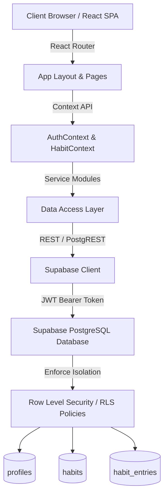

# HabitFlow — College Project Presentation & Viva Guide

**Tagline:** Small steps. Lasting change.  
**Domain:** Full-Stack Web Development, Cloud Databases, Daily Habit & Routine Tracking  
**Author / Presenter:** Developer Portfolio & College Capstone Presentation  

---

## 1. Five Presentation Slides

### Slide 1: Problem Statement & Proposed Solution
* **The Problem:**
  * Modern productivity tools are often overloaded with complex features, subscriptions, or rigid gamification that demotivates users when they miss a single day.
  * Habit drop-off typically happens within 14 days because users lack clear, simple visual feedback and realistic schedule flexibility (e.g., non-daily workout routines).
* **Our Solution — HabitFlow:**
  * A fast, minimalist, and accessible habit tracking platform built around sustainable progress.
  * Distinctive visual design (Forest Green, Sage, Warm Ivory) prioritizing clarity, one-click daily completions, and flexible scheduling (Daily, Weekdays, Custom Weekly Goals).
  * Rigorous streak intelligence that evaluates habits only on days they are actually scheduled—ensuring a Monday-Wednesday-Friday habit is never penalized on Tuesday.

---

### Slide 2: Core Features & User Experience Flow
* **Interactive Dashboard:**
  * Contextual daily greeting based on local time.
  * Real-time progress bar: "X of Y habits completed (Z%)" computed directly from database records.
  * One-click completion toggling with celebratory confetti and optimistic UI updates.
* **Complete CRUD Habit Management:**
  * Create, Read, Update, Archive, Restore, and Delete habits.
  * Categorization (Health, Fitness, Learning, Productivity, Personal, Other).
  * Measurable targets (e.g., 20 minutes, 10 pages, 3 km).
* **Historical Calendar:**
  * Interactive monthly calendar with colored indicators for full, partial, and incomplete days.
  * Click-to-inspect daily panel allowing retrospective tracking and review.
  * Safe handling of future dates and archived habits.
* **Progress & Habit Analytics:**
  * Weekly & Monthly completion rate KPIs.
  * Recharts weekly activity bar chart comparing scheduled vs. completed occurrences.
  * 30-day activity heatmap grid inspired by contribution graphs.
  * Best-performing habits and struggling habits ranking.
* **Settings & Portability:**
  * Light (Warm Ivory) and Dark (Forest Night) theme persistence.
  * Timezone-aware date calculations.
  * One-click Data Export in JSON and CSV formats.

---

### Slide 3: Technology Stack & Architecture
* **Frontend:** React 19, Vite 8, TypeScript, Tailwind CSS v4, React Router 7, Lucide Icons, Recharts.
* **Backend & Database:** Supabase (Cloud PostgreSQL 15+), Supabase Auth, Row Level Security (RLS).
* **Architecture Diagram:**

* **Separation of Concerns:**
  * Presentation layer (React components) isolated from business logic (`dateUtils`, `habitSchedule`, `analytics`).
  * Pure functions covered by automated Vitest unit tests.
  * Direct client-to-database communication secured entirely by PostgreSQL RLS policies—eliminating the overhead of a redundant custom Express server.

---

### Slide 4: Database Design, Authentication & Live Demo
* **Relational Schema (`supabase/schema.sql`):**
  1. `profiles`: User metadata, display names, timezones, and theme preferences linked to `auth.users(id)`.
  2. `habits`: User habits with schedule rules (`JSONB`), target values, start dates, and archival timestamps.
  3. `habit_entries`: Daily completion records with a `UNIQUE(habit_id, entry_date)` constraint preventing duplicate entries.
* **Security & Row Level Security (RLS):**
  * Every table has RLS strictly enabled.
  * Policies guarantee users can only query, insert, edit, or delete their own rows (`auth.uid() = user_id`).
  * Database trigger checks and validates habit ownership before allowing entry modification to prevent forgery.
* **Authentication:**
  * Supabase Auth handles password hashing, JWT issuance, and session token renewal.
  * Built-in Demo Mode allows 100% offline functionality and local storage fallback during live viva evaluations if cloud credentials are not supplied.

---

### Slide 5: Results, Limitations & Future Scope
* **Key Achievements:**
  * Clean, production-ready codebase built strictly with TypeScript and Tailwind CSS.
  * Zero off-by-one calendar errors through local ISO date formatting (`YYYY-MM-DD`).
  * 13 automated unit tests validating streak math, schedule evaluation, and completion rates.
  * Responsive across mobile phones, tablets, and desktop displays.
* **Current Limitations:**
  * Native mobile push notifications require PWA service worker push integration.
  * Cloud sync requires active internet connectivity when connected to Supabase.
* **Future Enhancements:**
  * Progressive Web App (PWA) with offline-first background synchronization.
  * Social habit sharing and accountability partner circles.
  * Gamified milestone badges and streaks exportable as social badges.

---

## 2. 60-Second Project Introduction (Elevator Pitch)

> *"Good morning, esteemed professors and committee members. Today I am presenting **HabitFlow**, a modern full-stack web application designed to help people build lasting daily routines through simple habit tracking, clear visual feedback, and flexible scheduling.
>
> Many existing habit applications are either cluttered with overwhelming features or punish users when they don't perform a habit on an unscheduled day. HabitFlow solves this with an intuitive, responsive user interface built using React, TypeScript, and Tailwind CSS, backed by a real PostgreSQL database on Supabase.
>
> With HabitFlow, users can create habits with customized daily, weekday, or weekly targets, mark habits complete with a single click, visualize weekly trends and a 30-day consistency heatmap, and export their records to CSV or JSON. Most importantly, all user data is fully isolated and secured at the database layer using PostgreSQL Row Level Security (RLS). Thank you, and I look forward to walking you through the live demonstration."*

---

## 3. Two-Minute Project Walkthrough

> *"To explain the architecture and workflow of HabitFlow in greater detail:
>
> **1. Architectural Foundation:**  
> The application is engineered with React and Vite for blazing fast client performance. Instead of maintaining a traditional Node.js/Express server that simply relays queries, we leveraged Supabase. The browser securely communicates directly with PostgreSQL via Supabase's client library, where security is enforced through PostgreSQL Row Level Security policies rather than relying on application-level filtering.
>
> **2. The User Journey:**  
> When a user logs in, they land on the **Today Dashboard**. Here, the header displays a contextual greeting and today's date. The dashboard calculates the daily completion percentage in real time by querying scheduled habits versus completed habit entries. Division by zero is safely guarded if no habits are scheduled.
>
> **3. Habit Management & Flexible Scheduling:**  
> In the **My Habits** tab, users have full CRUD capabilities. They can filter by categories like Health, Fitness, and Learning. Crucially, scheduling supports non-daily frequencies. For example, a gym routine scheduled on Monday, Wednesday, and Friday is evaluated only on those days, meaning its streak remains intact on Tuesday.
>
> **4. Calendar & Analytics:**  
> The **Calendar** view renders a monthly grid showing completed and missed habit counts, with a side panel allowing retroactive logging. In **Progress**, we use Recharts to display weekly bar graphs and a 30-day heatmap indicating consistency levels over time.
>
> **5. Reliability and Testing:**  
> All date calculations avoid UTC shifts by operating in local calendar strings (`YYYY-MM-DD`). Business logic is thoroughly tested with 13 automated Vitest unit tests covering streaks, ranges, and schedules. If cloud credentials are not supplied, the app gracefully switches to an offline storage engine, making live demonstrations completely bulletproof."*

---

## 4. Five Common Viva Questions & Accurate Answers

### Q1: Why did you use Supabase and PostgreSQL RLS instead of a custom Express.js backend?
**Answer:**  
*"In traditional architectures, developers build an Express API that performs user authentication and queries the database. This adds boilerplate and introduces potential security vulnerabilities if an endpoint forgets to filter by `req.user.id`.  
Supabase provides direct access to PostgreSQL with Row Level Security (RLS). With RLS policies like `auth.uid() = user_id`, the database engine itself enforces multi-tenant isolation. Even if a malicious client makes an arbitrary SQL or REST call, PostgreSQL will physically deny access to other users' rows. This reduces architectural complexity, improves query latency, and provides enterprise-grade database security."*

### Q2: How did you solve the common timezone off-by-one date error in habit tracking?
**Answer:**  
*"Standard JavaScript `new Date().toISOString()` converts local time to UTC. For example, in UTC+5:30 (India) or UTC-8 (California), 11:30 PM will roll over to the next or previous UTC date, causing habits completed today to be recorded on the wrong calendar day.  
In HabitFlow, we created a dedicated `dateUtils.ts` module that formats calendar dates using local components (`getFullYear()`, `getMonth() + 1`, `getDate()`) to generate strict `YYYY-MM-DD` strings. Both our database `entry_date` column (type `DATE`) and our frontend calculations operate exclusively on these local calendar dates, ensuring 100% accuracy regardless of the user's timezone."*

### Q3: How does your streak calculation algorithm handle habits scheduled on alternate days?
**Answer:**  
*"A naive streak implementation simply counts consecutive calendar days. That breaks for habits like 'Weightlifting scheduled on Mon, Wed, Fri', because Tuesday would reset the streak.  
In HabitFlow's `analytics.ts`, the `calculateStreak` function first filters the calendar to only those dates where the habit was actually scheduled according to its rules. It then checks backwards across those scheduled days. Furthermore, we implemented an in-progress grace period: if today is scheduled but not yet completed, the streak from the previous scheduled day is preserved until midnight, giving the user the opportunity to complete today without losing their streak."*

### Q4: How do you prevent duplicate entries when a user clicks the complete button multiple times?
**Answer:**  
*"We implement dual-layer protection:
1. **Frontend Optimistic State:** The UI prevents double submissions by debouncing requests and maintaining local entry state.
2. **Database Constraint:** In our PostgreSQL schema, the `habit_entries` table has a composite unique constraint: `CONSTRAINT unique_habit_date_entry UNIQUE (habit_id, entry_date)`. When logging a completion, we perform an `UPSERT` (`INSERT ... ON CONFLICT (habit_id, entry_date) DO UPDATE`), guaranteeing that duplicate entries can never exist in the database even under concurrent network requests."*

### Q5: What happens if a user deletes a habit? Does it leave orphaned entry rows?
**Answer:**  
*"No, because our relational schema implements `ON DELETE CASCADE` on all foreign key constraints. In `supabase/schema.sql`, the `habit_entries.habit_id` column references `habits(id) ON DELETE CASCADE`. When a habit is deleted, PostgreSQL automatically and atomically removes all associated daily entries in the same transaction, preventing database orphan records and maintaining relational integrity."*

---

## 5. Simple Explanations of Core Technical Concepts

| Concept | Simple Explanation for Viva / Presentation |
| :--- | :--- |
| **React** | A declarative component-based JavaScript library for building responsive user interfaces with reactive state updates. |
| **Supabase** | An open-source Backend-as-a-Service (BaaS) providing a hosted PostgreSQL database, authentication, auto-generated APIs, and real-time events. |
| **PostgreSQL** | An enterprise-grade, relational SQL database known for robust ACID transactions, strict data types, and advanced constraints. |
| **CRUD** | The four foundational operations of persistent storage: **C**reate, **R**ead, **U**pdate, and **D**elete. |
| **Authentication** | The process of verifying a user's identity (via email/password or tokens) and granting an authorized session. |
| **Row Level Security (RLS)** | A PostgreSQL security feature where table rows are filtered and restricted based on the authenticated user's ID (`auth.uid()`), verified directly in the database engine. |
